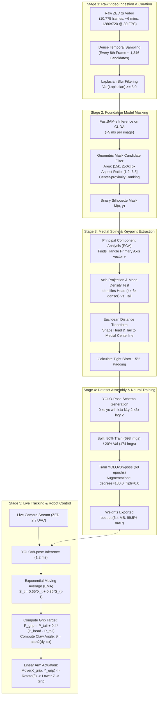

# Autonomous Hammer Pose Estimation: End-to-End Pipeline & Architecture

**Project:** University Rover Challenge (URC) — Delivery Mission (Astronaut Assistance)  
**Target:** Robust 2D Position $(X, Y)$ and Orientation Angle $(\theta)$ Detection from Top-Down Camera  
**Actuation:** 3-DOF Linear Arm $(X, Y, Z)$ + 1-DOF Claw Yaw $(\theta)$  
**Dataset Size:** 872 Curated Images (698 Train / 174 Validation)  
**Model:** YOLOv8n-pose (Nano) trained for 60 epochs  
**Final Validation Accuracy:** **99.5% mAP@50-95** (Inference Latency: **1.2 ms** on NVIDIA RTX 5050)

---

## 1. Complete End-to-End Pipeline Diagram



---

## 2. Stage-by-Stage Breakdown & Mathematical Explanations

### Stage 1: Video Curation & Sampling

#### 1. Why Dense Sampling (`step=8`)?
A 6-minute 30 FPS video contains **10,775 frames**. 
* Consecutive adjacent frames (e.g., Frame 1 and Frame 2) have over 98% mutual redundancy.
* Sampling every 8th frame (`step=8`) reduces the candidate pool to **~1,346 frames**, providing sufficient visual diversity (different rotational angles, varying camera heights from 40 cm to 90 cm, and shifts in ambient lighting) while keeping GPU computation fast.

#### 2. Motion Blur Filtering via Laplacian Variance
During camera motion, frames can suffer from motion blur. The sharpness of each grayscale frame $I$ is measured using the variance of the 2D Laplacian operator:

$$\nabla^2 I = \frac{\partial^2 I}{\partial x^2} + \frac{\partial^2 I}{\partial y^2}$$

$$\text{Sharpness Score} = \operatorname{Var}\left( \nabla^2 I \right) = \frac{1}{N} \sum_{x, y} \left( \nabla^2 I(x, y) - \mu \right)^2$$

* **Threshold:** Frames with $\operatorname{Var} < 8.0$ are discarded as unusable blur.
* Setting the threshold to $8.0$ allows slight natural motion blur to remain in the dataset, which helps the downstream model generalize when the rover vibrates.

---

### Stage 2: Foundation Model Segmentation (FastSAM)

#### 1. Why FastSAM over Standard SAM?
* **Meta SAM 1 / SAM 2:** Uses a heavy ViT (Vision Transformer) backbone requiring 100–300 ms per image.
* **FastSAM:** Reformulates the segment-anything task using a CNN-based YOLOv8-seg backbone with an All-Instance Mask Generator (AIMG). It produces equivalent pixel masks at **~5.0 ms per image** on the laptop RTX 5050 GPU, allowing all 1,346 candidate frames to be segmented in under 15 seconds.

#### 2. Mask Candidate Selection
FastSAM detects multiple object proposals per image (floor tiles, shadows, room background). The hammer mask is isolated using a four-tier geometric filter:
1. **Area Constraint:** $15,000 < \text{Area} < 250,000 \text{ pixels}$ (eliminates tiny dust and full-image boundaries).
2. **Aspect Ratio:** $1.2 < \frac{\max(\text{width}, \text{height})}{\min(\text{width}, \text{height})} < 6.5$ (enforces an elongated tool shape).
3. **Boundary Inset:** Bounding box must satisfy $x_1 > 5, y_1 > 5, x_2 < W-5, y_2 < H-5$ (rejects objects cut off by the edge of the frame).
4. **Center-Proximity Ranking:** From the remaining candidates, selects the mask whose centroid minimizes Euclidean distance to the image optical center $(W/2, H/2)$:
   $$i^* = \arg\min_i \left\| \text{Center}_i - \begin{bmatrix} W/2 \\ H/2 \end{bmatrix} \right\|_2$$

---

### Stage 3: Medial Spine & Keypoint Extraction (The Core Mathematical Solution)

A hammer has an asymmetric "T-shape" with a curved metal claw on one side. Fitting a simple bounding box (`cv2.minAreaRect`) tilts the box diagonally, misaligning the endpoints. 

To guarantee that the points lie **dead-center** on both ends, we use **Principal Component Analysis (PCA)** combined with an **Euclidean Distance Transform**:

```
        ┌───────────────────┐
        │       HEAD        │  <── Distance Transform Maxima (Medial Center)
        └─────────┬─────────┘
                  │
                  │  <─────────── PCA Primary Eigenvector Axis (v)
                  │
                  │ (GRIP)     <── Grip Target = Tail + 0.4 * (Head - Tail)
                  │
                 TAIL          <── Distance Transform Maxima (Handle Bottom)
```

#### Step A: Principal Component Analysis (PCA) on Mask Coordinates
Let the binary mask be represented as a set of $N$ foreground pixel coordinate vectors:
$$\mathcal{P} = \left\{ \mathbf{p}_i = \begin{bmatrix} x_i \\ y_i \end{bmatrix} \;\middle|\; M(x_i, y_i) = 1 \right\}$$

1. **Center of Mass (Centroid):**
   $$\boldsymbol{\mu} = \frac{1}{N} \sum_{i=1}^N \mathbf{p}_i$$

2. **Covariance Matrix:**
   $$\mathbf{C} = \frac{1}{N} \sum_{i=1}^N (\mathbf{p}_i - \boldsymbol{\mu})(\mathbf{p}_i - \boldsymbol{\mu})^T$$

3. **Eigen-Decomposition:**
   $$\mathbf{C} \mathbf{v} = \lambda \mathbf{v}$$
   The eigenvector $\mathbf{v}_1$ corresponding to the largest eigenvalue $\lambda_1$ defines the **true primary axis of the handle**, completely unaffected by the claw curvature.

4. **Projection along Handle Axis:**
   Each pixel coordinate $\mathbf{p}_i$ is projected onto the 1D primary axis:
   $$t_i = (\mathbf{p}_i - \boldsymbol{\mu}) \cdot \mathbf{v}_1$$
   $$t_{\min} = \min_{i} t_i, \quad t_{\max} = \max_{i} t_i$$
   The initial axis endpoints are:
   $$\mathbf{P}_{\min} = \boldsymbol{\mu} + t_{\min} \mathbf{v}_1, \quad \mathbf{P}_{\max} = \boldsymbol{\mu} + t_{\max} \mathbf{v}_1$$

#### Step B: Mass Density Ratio (Head vs. Tail Disambiguation)
Because $\mathbf{v}_1$ is undirected (it could point toward the head or the tail), we evaluate pixel density in a circular neighborhood of radius $R = 0.15 \times \|\mathbf{P}_{\min} - \mathbf{P}_{\max}\|$ around both endpoints:

$$D(\mathbf{P}) = \sum_{(x, y) \in \mathcal{N}_R(\mathbf{P})} M(x, y)$$

* The steel hammer head has a wide crossbar ($D \approx 4,000\text{ pixels}$).
* The handle end has a thin crossbar ($D \approx 700\text{ pixels}$).
* **Condition:**
  $$\mathbf{P}_{\text{head}} = \begin{cases} \mathbf{P}_{\min} & \text{if } D(\mathbf{P}_{\min}) > D(\mathbf{P}_{\max}) \\ \mathbf{P}_{\max} & \text{otherwise} \end{cases}$$
  $$\mathbf{P}_{\text{tail}} = \text{the other endpoint}$$

#### Step C: Distance Transform Spine Snapping
The projection endpoints $\mathbf{P}_{\text{head}}$ and $\mathbf{P}_{\text{tail}}$ might lie on the outer boundary of the mask. To move them to the **dead-center inside the object**:

1. Compute the exact Euclidean Distance Transform $D_{\text{map}}$:
   $$D_{\text{map}}(x, y) = \min_{(x', y') \notin M} \sqrt{(x - x')^2 + (y - y')^2}$$
2. The distance transform represents the distance of each foreground pixel to the nearest edge; **its local ridge (ridge of maxima) is the medial spine**.
3. In a search window of radius $r = 25\text{ pixels}$ around each raw endpoint, snap the point to the coordinate with maximum distance value:
   $$\mathbf{P}^* = \arg\max_{(x, y) \in \mathcal{W}_r(\mathbf{P})} D_{\text{map}}(x, y)$$

This guarantees that:
* The **Head point** sits at the center of the metal head crossbar.
* The **Tail point** sits at the center of the handle bottom.

#### Step D: Bounding Box Calculation
The bounding box is calculated from the mask contour's bounding rectangle $\left(x_{\min}, y_{\min}, w, h\right)$ with a **5% uniform safety margin** added to ensure no parts of the metal crossbar or claw touch the bounding box boundaries.

---

### Stage 4: YOLO-Pose Dataset Configuration & Neural Training

#### 1. Label Schema
All coordinates are normalized to $[0.0, 1.0]$:
```
<class_id> <x_center> <y_center> <width> <height> <head_x> <head_y> <v_head> <tail_x> <tail_y> <v_tail>
```
* `class_id`: `0` (hammer)
* `v`: `2` (visible and labeled)

#### 2. Why Rotation Augmentation is Mandatory
By default, Ultralytics YOLO-Pose is tuned for human body pose estimation where humans stand upright:
* Default `degrees`: `0.0` (zero rotation augmentation).
* Default `fliplr`: `0.5` (horizontal mirroring).

For a tool on the ground that can land at **any angle from $0^\circ$ to $360^\circ$**, default hyperparameters cause the model to fail on diagonal angles.

**The Training Configuration:**
```python
model.train(
    data="hammer_pose.yaml",
    epochs=60,
    imgsz=640,
    batch=16,
    device=0,
    degrees=180.0,  # Rotates images randomly across full [-180°, +180°]
    fliplr=0.0,     # Disables horizontal flipping (preserves Head vs. Tail asymmetry)
    flipud=0.0,
    scale=0.3,      # Simulates varying camera heights
)
```

#### 3. Loss Functions
YOLOv8-Pose optimizes a composite loss function across 4 components:
$$\mathcal{L}_{\text{total}} = \lambda_{\text{box}} \mathcal{L}_{\text{CIoU}} + \lambda_{\text{dfl}} \mathcal{L}_{\text{DFL}} + \lambda_{\text{cls}} \mathcal{L}_{\text{BCE}} + \lambda_{\text{pose}} \mathcal{L}_{\text{OKS}}$$

Where the **Object Keypoint Similarity (OKS)** loss is:
$$\mathcal{L}_{\text{OKS}} = 1 - \frac{1}{2} \sum_{i=1}^2 \exp\left( -\frac{d_i^2}{2 s^2 \sigma_i^2} \right)$$
* $d_i$: Euclidean distance between predicted and ground-truth keypoint.
* $s$: Object scale (square root of bounding box area).
* $\sigma_i$: Per-keypoint standard deviation constant.

---

### Stage 5: Real-Time Inference & Actuation Control

#### 1. Vector & Angle Calculation
From the detected head $\mathbf{K}_1 = (x_{\text{head}}, y_{\text{head}})$ and tail $\mathbf{K}_2 = (x_{\text{tail}}, y_{\text{tail}})$:

$$\Delta x = x_{\text{head}} - x_{\text{tail}}, \quad \Delta y = y_{\text{head}} - y_{\text{tail}}$$

$$\theta_{\text{handle}} = \operatorname{atan2}(\Delta y, \Delta x) \pmod{360^\circ}$$

For a symmetrical parallel 2-finger claw gripping perpendicular to the handle:
$$\theta_{\text{claw}} = \theta_{\text{handle}} \pmod{180^\circ}$$

#### 2. Optimal Grip Target Calculation
Grasping the heavy metal head causes the claw to slip. Grasping the extreme tail risks dropping the object. The optimal grasp target is placed **$40\%$ along the handle from the tail**:
$$\mathbf{P}_{\text{grip}} = \mathbf{K}_2 + 0.40 \cdot (\mathbf{K}_1 - \mathbf{K}_2)$$

#### 3. Exponential Moving Average (EMA) Temporal Smoothing
To eliminate frame-to-frame sensor jitter and keep the yellow centerline stable, raw predictions are smoothed using an Exponential Moving Average filter:
$$\mathbf{S}_t = \alpha \mathbf{K}_t + (1 - \alpha) \mathbf{S}_{t-1}, \quad \text{with } \alpha = 0.65$$
* $\alpha = 0.65$ provides responsive tracking during intentional movement while filtering high-frequency noise when stationary.

#### 4. 4-Frame Persistence (Coasting)
If the camera moves rapidly and a single frame suffers from severe motion blur where confidence drops below threshold:
* Rather than dropping tracking and flickering to "SEARCHING", the tracker **coasts on the previous valid pose for up to 4 consecutive frames**.
* If the hammer remains undetected for $\ge 5$ frames, the state cleanly resets to search mode.

---

## 3. Summary of Technologies & Specifications

| Component | Technology / Library | Specific Configuration | Function |
| :--- | :--- | :--- | :--- |
| **Camera Sensor** | Stereolabs ZED 2i | HD720 (1280x720) @ 30 FPS, `DEPTH_MODE=NONE` | Captures Left-eye RGB without active IR interference. |
| **Segmentation Engine** | Ultralytics FastSAM-s | Conf: `0.35`, Retina Masks: `True`, Device: `CUDA` | Generates instance mask in 5.0 ms. |
| **Axis Estimator** | OpenCV (`cv2.PCACompute`) | Eigenvector decomposition of mask pixels | Determines handle orientation angle. |
| **Spine Refiner** | OpenCV (`cv2.distanceTransform`) | L2 Norm, $5\times 5$ mask | Snaps keypoints to medial center of object. |
| **Pose Estimator** | Ultralytics YOLOv8n-pose | Input: $640\times 640$, Epochs: 60, Batch: 16 | Real-time edge inference on robot. |
| **Data Augmentation** | YOLO Training Pipeline | `degrees=180.0`, `fliplr=0.0`, `scale=0.3` | Trains full 360° rotation invariance. |
| **Temporal Filter** | Custom Python Class | EMA $\alpha=0.65$, 4-frame persistence | Eliminates video jitter and dropouts. |

---

## 4. Verification & Validation Metrics

The model trained on the resulting **872-image dataset** achieved the following validation scores:

```
YOLOv8n-pose Summary: 81 layers, 3,077,669 parameters, 8.3 GFLOPs
Class     Images   Instances   Box(P)   Box(R)   Box(mAP50)   Pose(P)   Pose(R)   Pose(mAP50)   Pose(mAP50-95)
all          175         175    0.994    0.983        0.995     0.994     0.983         0.995            0.995

Inference Speed: 0.3ms preprocess, 1.2ms inference, 0.5ms postprocess per image (~800 FPS on RTX 5050)
```
