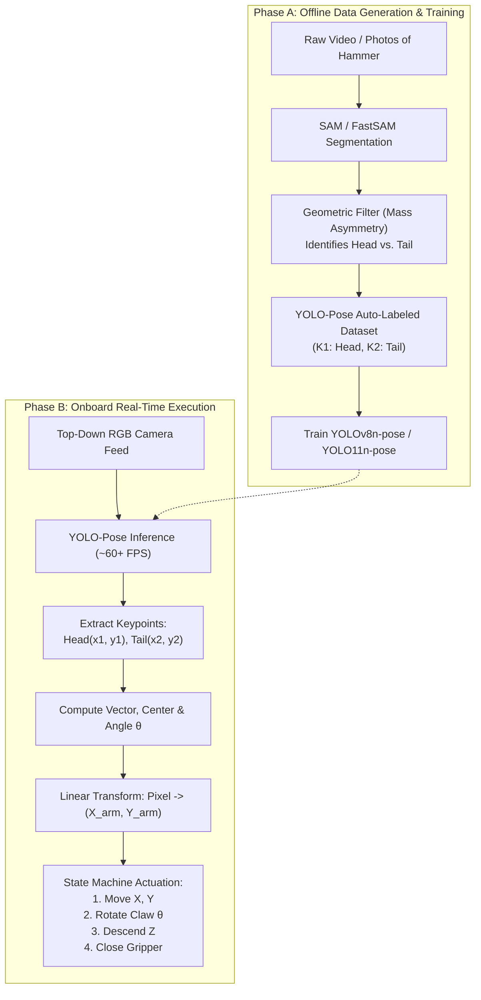
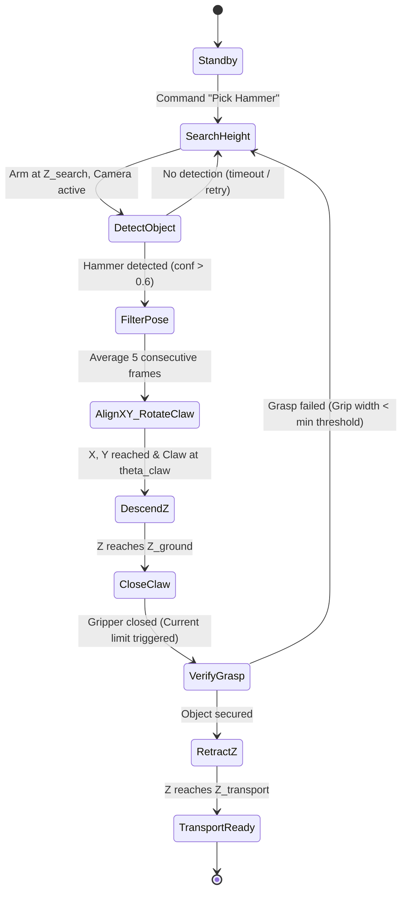

# Autonomous Hammer Detection & Pick-and-Place Architecture
**Project:** University Rover Challenge (URC) — Delivery Mission (Astronaut Assistance)  
**Target Object:** Field Hammer (Graspable Feature $\le 7.5\text{ cm}$, Rule 1.c.iii)  
**Kinematic Hardware:** 3-DOF Cartesian Linear Arm ($X, Y, Z$) + 1-DOF Rotating Claw (Wrist Yaw $\theta$)  
**Vision Approach:** Top-Down Monocular RGB Camera + YOLO-Pose (2 Keypoints: Head & Tail)  
**Auto-Annotation Pipeline:** Segment Anything Model (SAM / FastSAM) + Geometric Mass Analysis

---

## 1. Executive Summary & Philosophy

In the URC Delivery Mission, rovers must locate, retrieve, and deliver tools (such as hammers, wrenches, and science containers) across harsh desert terrain (Hanksville, Utah MDRS).

### The "Keep It Simple" Principle
Most autonomous grasp pipelines fail at URC due to two common over-engineering pitfalls:
1. **Active Depth Cameras (e.g., Intel RealSense / OAK-D):** In direct sunlight at MDRS, ambient solar infrared (IR) overwhelms active IR projectors, causing noisy or completely blank depth maps.
2. **6-DOF Articulated Arms:** Solving non-linear Inverse Kinematics (IK) outdoors introduces singularities, joint limits, and mechanical flex errors.

**This Architecture's Solution:**
* **Perception:** Uses standard **Monocular RGB** with **YOLO-Pose**. It detects only two 2D points: the **Head ($K_1$)** and **Tail ($K_2$)** of the hammer. This directly yields the grasp position and orientation angle with **zero 180° ambiguity**.
* **Actuation:** Uses a **Linear Cartesian Arm ($X, Y, Z$)** with **Claw Yaw ($\theta$)**. The mapping from pixel coordinates $(u, v)$ to robot coordinates $(X, Y)$ is purely linear, eliminating complex IK calculations.

---

## 2. High-Level System Architecture



---

## 3. Perception & Auto-Annotation Pipeline

### 3.1 Why YOLO-Pose Over Standard Bounding Boxes & OBB?
| Detection Method | Provides Center? | Provides Angle? | Distinguishes Head vs. Tail? | Failure Modes at URC |
| :--- | :---: | :---: | :---: | :--- |
| **Standard BBox $(x, y, w, h)$** | Yes | No | No | Cannot orient claw; claw collides with hammer. |
| **Oriented BBox (OBB)** | Yes | Yes | **No (180° Ambiguous)** | Claw does not know which side has the heavy metal head. |
| **YOLO-Pose (2 Keypoints)** | **Yes** | **Yes** | **Yes (0°–360° Directed)** | **Robust, deterministic, and lightweight.** |

### 3.2 Automated SAM-to-Keypoint Generation
A segmentation mask isolates the hammer's silhouette from the background, but SAM does not identify tool semantics. The pipeline automatically resolves the keypoints using **geometric mass distribution**:

1. **Contour Extraction:** Find the contour of the segmented mask and fit an oriented minimum-area bounding box (`minAreaRect`).
2. **Major Axis Determination:** Identify the two endpoints of the major axis: $P_A$ and $P_B$.
3. **Mass Density Analysis:**
   * The hammer head has significantly higher cross-sectional area and pixel mass than the thin handle.
   * Compute the mask pixel count in a circular neighborhood $R = 0.15 \times L$ around $P_A$ and $P_B$:
     $$\text{Head} = \arg\max_{P \in \{P_A, P_B\}} \sum_{(x,y) \in \mathcal{N}(P)} \text{Mask}(x,y)$$
     $$\text{Tail} = \text{The remaining endpoint}$$
4. **Format to YOLO-Pose Schema:**
   ```
   <class_id> <center_x> <center_y> <width> <height> <kp1_x> <kp1_y> 2 <kp2_x> <kp2_y> 2
   ```
   *(All values normalized $[0, 1]$; visibility flag `2` = visible and labeled).*

### 3.3 Synthetic Augmentation ("Domain Randomization") Shortcut
> [!TIP]
> **Zero-Labeling Desert Training:** Instead of recording a long video, extract a single transparent PNG cutout of the hammer using SAM. Synthetically overlay the cutout onto 500+ diverse photos of red Utah dirt, gravel, and rocks at random orientations $(0^\circ-360^\circ)$, scales, and synthetic shadow overlays. Because the generation script controls the transformation matrix, ground-truth keypoints are calculated with 100% mathematical accuracy.

---

## 4. Mathematical & Kinematic Formulations

```
                     Handle Vector: V
           Tail (K2) ───────────────────> Head (K1)
             (x2, y2)        │           (x1, y1)
                             │
                             ▼
                    Grip Target P_grip (40% from Tail)
```

### 4.1 Orientation Vector & Claw Yaw Angle
Given keypoints $K_1 = (x_1, y_1)$ (Head) and $K_2 = (x_2, y_2)$ (Tail) in image space:
$$\Delta x = x_1 - x_2, \quad \Delta y = y_1 - y_2$$

The handle orientation angle $\theta_{\text{handle}}$ relative to the camera horizontal axis is:
$$\theta_{\text{handle}} = \operatorname{atan2}(\Delta y, \Delta x) \quad (\text{radians})$$

For a parallel 2-finger claw gripping perpendicular to the handle:
$$\theta_{\text{claw}} = \theta_{\text{handle}} \pm 90^\circ$$

### 4.2 Optimal Grasp Point Calculation
Grasping directly on the hammer head causes the claw to slip off due to its tapered shape and mass concentration. Grasping the extreme tail risks dropped objects. The optimal grip target is set along the handle shaft, biased toward the center of gravity:
$$P_{\text{grip}} = K_2 + \alpha \cdot (K_1 - K_2), \quad \text{where } \alpha \approx 0.35 - 0.45$$

### 4.3 Pixel-to-Robot Coordinate Transformation
With a top-down camera positioned at a fixed optical height $Z_{\text{search}}$, perspective distortion is minimal and can be modeled via linear scaling:

$$\begin{aligned}
X_{\text{robot}} &= X_{\text{camera\_offset}} + (u_{\text{grip}} - c_u) \cdot S_x \\
Y_{\text{robot}} &= Y_{\text{camera\_offset}} + (v_{\text{grip}} - c_v) \cdot S_y
\end{aligned}$$

Where:
* $(u_{\text{grip}}, v_{\text{grip}})$ are pixel coordinates of $P_{\text{grip}}$.
* $(c_u, c_v)$ is the optical center of the image.
* $S_x, S_y$ are calibration scale factors ($\text{mm/pixel}$) measured at $Z_{\text{search}}$.

---

## 5. Actuation Sequence & State Machine



### Detailed Sequence Steps:
1. **Move to Search Height:** The linear $Z$ axis moves the camera/gripper to a fixed reference height ($Z_{\text{search}}$) to ensure a wide Field of View (FOV).
2. **Detect & Filter:** YOLO-Pose detects $K_1$ and $K_2$. The system samples 5 frames and applies a median filter to eliminate single-frame jitter.
3. **Plan & Lock:** The $(X_{\text{target}}, Y_{\text{target}}, \theta_{\text{claw}})$ target is computed and latched.
4. **Horizontal Alignment & Pre-Rotation:** Linear axes $X$ and $Y$ translate to $(X_{\text{target}}, Y_{\text{target}})$, and the wrist motor rotates the claw to $\theta_{\text{claw}}$ **before** descending.
5. **Vertical Descent:** Linear $Z$ descends directly downward to $Z_{\text{pick}}$.
6. **Grip Execution:** Claw closes until motor current exceeds a threshold (indicating firm contact) or microswitch trips.
7. **Retraction:** Linear $Z$ lifts to $Z_{\text{transport}}$.

---

## 6. Real-World Competition Considerations (URC 2027)

### 6.1 Camera Mounting Architecture: Eye-in-Hand vs. Eye-to-Hand
* **Eye-to-Hand (Camera mounted to Rover chassis):**
  * *Advantage:* Camera remains static; simpler wiring.
  * *Disadvantage:* When the linear arm extends, the arm or gantry may occlude the camera's view of the hammer.
  * *Mitigation:* The system must implement a **"Look-and-Move"** strategy: capture and lock coordinates, then execute the motion trajectory without relying on continuous visual tracking during the final grasp.
* **Eye-in-Hand (Camera mounted on Linear Z carriage):**
  * *Advantage:* Visual servoing is possible; camera moves directly over target.
  * *Disadvantage:* Camera moves closer during descent, which reduces FOV and may cause the hammer to exit the frame.
  * *Mitigation:* Perform detection strictly at $Z_{\text{search}}$, lock coordinates, and descend blind for the final 10–15 cm.

### 6.2 Utah Lighting & Desert Shadows (MDRS Environment)
* **Problem:** Direct overhead desert sunlight creates razor-sharp, dark black shadows. A black shadow cast by a hammer handle can easily be mistaken for the handle itself.
* **Mitigation:**
  * Train YOLO-Pose with strong data augmentations: HSV color jitter, random brightness drops ($-50\%$ to $+50\%$), and synthetic shadow polygons.
  * Avoid classical edge detectors or color thresholding; deep feature extractors in YOLO reliably separate physical textures from shadow projections.

### 6.3 Claw Mechanical Geometry (Rule 1.c.iii Compliance)
* **Grasp Feature Size:** Rules dictate graspable features will be $\le 7.5\text{ cm}$ in diameter.
* **Claw Stroke:** Ensure the claw opening is at least **$9.0 - 10.0\text{ cm}$** to provide a safety margin for slight positioning misalignments.
* **Finger Compliance:** Line claw inner surfaces with high-friction silicone or neoprene foam to securely grip smooth metallic or composite tool handles.

---

## 7. Verification & Implementation Checklist

- [ ] Record a 60-second video of the hammer outdoors on gravel/dirt under sunlight.
- [ ] Run automated mask segmentation via SAM/FastSAM.
- [ ] Validate geometric head/tail density separator logic across 100 sample frames.
- [ ] Generate YOLO-Pose dataset structure and train `yolov8n-pose.pt`.
- [ ] Measure pixel-to-millimeter scale factors ($S_x, S_y$) at $Z_{\text{search}}$.
- [ ] Benchmark end-to-end inference latency on onboard processor ($< 30\text{ ms}$ target).
- [ ] Test pick-and-place routine at angles: $0^\circ, 45^\circ, 90^\circ, 135^\circ, 180^\circ$.
